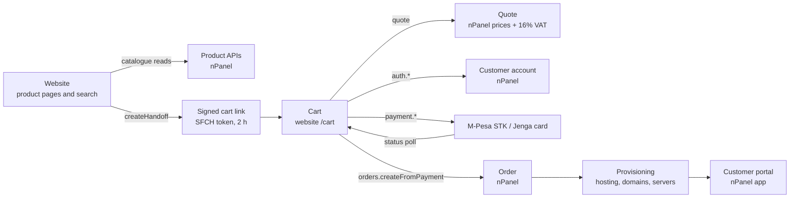

# Nisc Cloud commerce architecture: website, nPanel and provisioning

Status: 7 November 2026. Written from the website source (`apps/www.nisccloud.com`) and read-only calls to the live nPanel API. The nPanel backend source was not available, so everything on the backend side describes observed behaviour and the contracts the website relies on, not the implementation. Findings and actions referenced as C-*, S-* and B-* are in `pre-launch-remediation-log.md`.

## The flow

All website calls go to `/api/trpc/*`, which Vercel (and the local Bun host) proxies to `https://npanel-server.nisccloud.com`. The browser never holds provider credentials.

## Who owns what

| Stage | Website owns | nPanel backend owns |
| --- | --- | --- |
| Product pages | Layout, copy, claims, display rules (for example the "99.99% uptime target" row), loading states, caching of display-only reads | Catalogue: plans, features, prices, margins, FX rates, availability of server stock |
| Domain search | Query parsing, batching and queueing registry checks, honest waiting and retry states, never showing an unverified domain as available | Registry and registrar access (KeNIC EPP session, international registrar), availability, fees |
| Cart link | Asking for a link with the chosen product | Signing the link (HS256, 2-hour expiry), validating product ids |
| Cart | Options UI (billing cycle, add-ons, upsells), keeping options across sign-in (`sessionStorage`, 2 h) | **The price.** `storefront.cart.quote` is authoritative; the website only displays it |
| Account | Forms and the redirect back from nPanel sign-in | Accounts, organisations, checkout tokens |
| Payment | Starting a payment, showing progress, Jenga redirect and return | Talking to M-Pesa and Jenga, recording the result, callbacks |
| Order | Currently triggers order creation after it sees a successful payment | Creating the order, tying it to the payment, invoices |
| Provisioning | Nothing | Creating hosting accounts, registering domains, ordering servers, emails to the customer |
| After sale | Links to the portal and support | Portal, renewals, reminders, support tickets |

The rule the website follows: it may decide how things look and how long it waits, but it never decides a price, an availability answer or whether an order exists.

## Integration contracts the website depends on

### Catalogue (display only)

| Procedure | Used for | Notes |
| --- | --- | --- |
| `products.getHostingPlansForPricing`, `getWordPressPlansForPricing`, `getEmailHostingPlansForPricing`, `getSeoPlansForPricing`, `getNiscEmailMarketingPlansForPricing` | Package cards | Returns plans, prices, feature values and feature labels. Catalogue data issues are B-10. |
| `hivelocity.publicGetVpsPlans`, `publicGetVdsPlans`, `publicGetDedicatedServerPlans`, `publicGetFacilities`, `publicGetProductOptions`, `publicGetProductOperatingSystems` | Server pages and cart configuration | Cold VPS list took 20 s (B-6). Procedure names expose the provider (B-9). |
| `hivelocityPricingSettings.get`, `publicPricing.getMarginMap`, `getDefaultMarginConfig`, `getExchangeRatesPublic` | Turning upstream USD costs into KES display prices | VDS and Dedicated have no margin configured (S-1, B-2). |

### Domains

| Procedure | Contract |
| --- | --- |
| `kenic.domainCheck.check` (POST) | Input: list of `.ke` names, `withFee`, `currency`, `periodYears`. Output: `normalized[]` with `available`, `createFee`, `renewFee`, `transferFee`. Must never report a name as available unless the registry said so. Currently 4–12 s warm and 33–53 s cold (B-4); returns raw EPP XML (B-8). |
| `openProvider.domains.checkAvailability` | International names; 1–10 s. Name exposes the registrar (B-9). |
| `domainTransfer.checkTransfer`, `whois.lookup` | Transfer eligibility and WHOIS display. |

### Cart, account, payment, order

| Procedure | Contract | Status |
| --- | --- | --- |
| `storefront.cart.createHandoff` | Signs the selected product into a 2-hour link. Must ignore any client price. | Ignores price for registrations; **trusts client price for transfers** (C-1, B-1). |
| `storefront.cart.quote` | Returns line items, VAT and total from server-side prices. | Pass for hosting, servers and registrations. Does not recheck availability (C-2). Calls the registry on every quote (C-7, B-5). No renewal price (B-14). |
| `storefront.auth.checkEmail`, `register`, `completeProfile`, `createOrganization`, `checkoutIdentity`, `issueCheckoutToken` | Create or identify the customer and issue the token used by payment calls. | Not exercised (would create real accounts). |
| `storefront.payment.initiateStkPush`, `pollPaymentStatus`, `queryStkPush` | M-Pesa STK push and status. | Not exercised (real money). |
| `storefront.payment.initiateJengaCheckout`, `getJengaPaymentStatus` | Card payment via a POST redirect to Jenga; status on return, including the stored order intent. | Not exercised. |
| `storefront.orders.createFromPayment` | Creates the order after payment. Input includes the cart again. | Not exercised. Must not depend on the browser (B-12) and must not trust the re-sent cart (B-13). |

### Other

`storefront.leads.submit` (contact and corporate enquiries), `support.guest.*` and `tickets.*` (support), `zeepoAiSupport.*` (chat assistant). None of these affect the purchase path.

## What could not be verified, and why

Everything after the quote: account creation, payment, order creation, provisioning, customer emails and the portal hand-over. Each step either creates real records or moves real money, which the brief forbids during testing.

## What is needed to finish end-to-end testing (B-11)

1. **Payment sandboxes:** M-Pesa Daraja sandbox credentials (shortcode, passkey, callback URL pointing at a non-production nPanel) and a Jenga sandbox merchant.
2. **A non-production nPanel environment** (or a test flag on production) where orders are created but provisioning is skipped or uses test accounts, so no real hosting, domain or server is bought.
3. **Registry and registrar test access:** KeNIC OT&E (test) EPP credentials and the international registrar's sandbox, so domain registration can be exercised without registering real names.
4. **A test customer account and organisation** that can be reset.
5. **Answers from the backend team:** where order creation happens on payment callbacks (B-12); how `createFromPayment` checks the amount paid (B-13); what happens when a domain registration fails after payment (refund or credit, B-3).

With those, the remaining journey test is: domain only, hosting only, domain plus hosting, VPS; each paid by M-Pesa and by card; plus a failed payment, a cancelled payment, a closed tab after payment, and a domain taken between search and payment.
