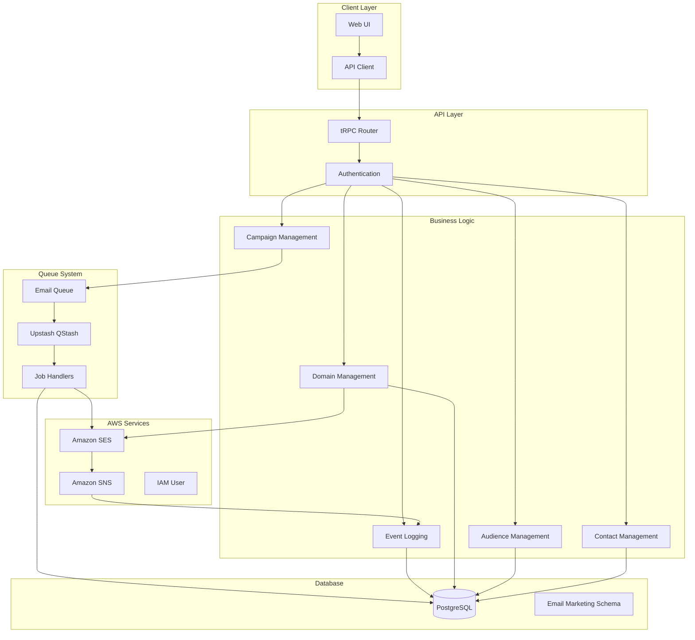
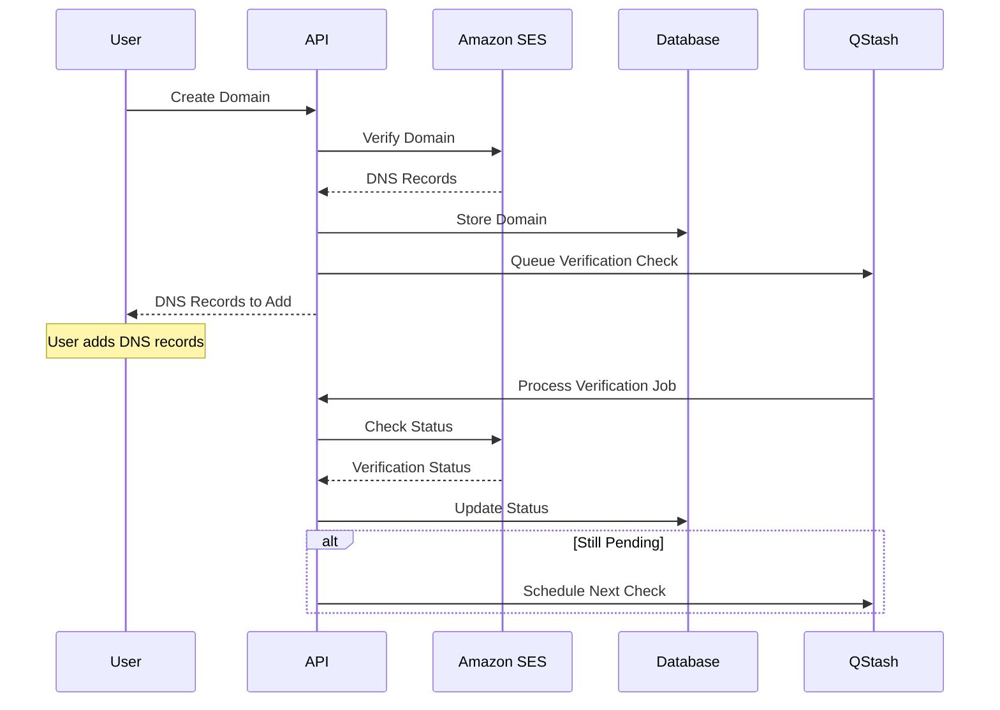
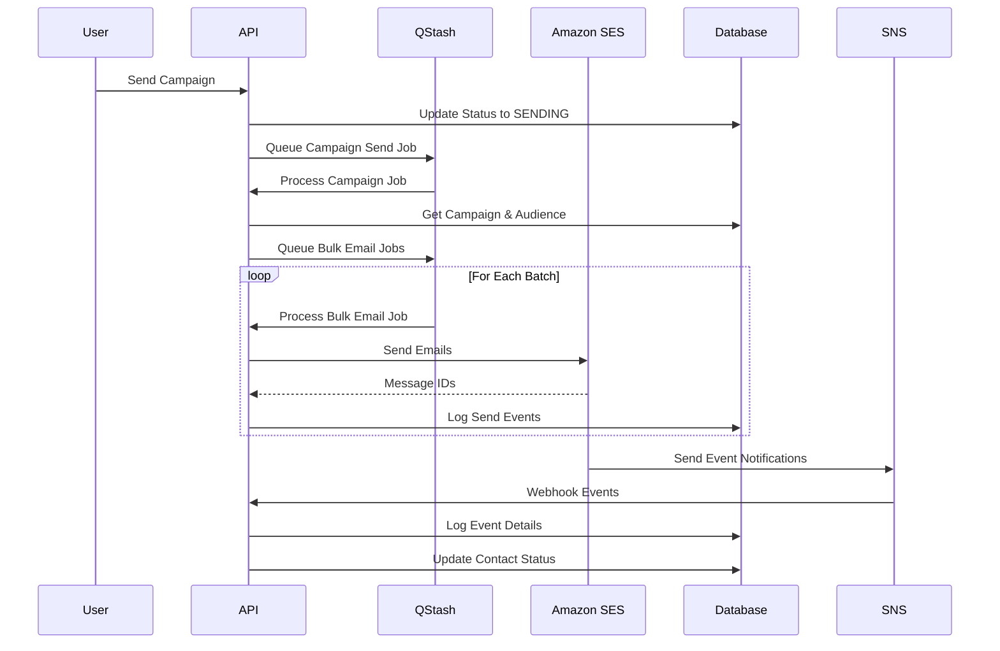
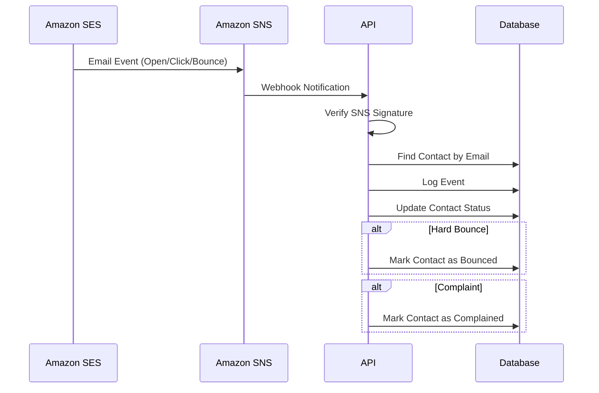

# Email Marketing Service Architecture

## Overview

The email marketing service is a comprehensive solution built on Amazon SES with a fault-tolerant queue system, real-time event tracking, and multi-tenant support. It provides Resend-like functionality with domain management, campaign organization, audience management, and detailed analytics.

## System Architecture

## Data Flow

### 1. Domain Verification Flow

### 2. Campaign Sending Flow

### 3. Event Tracking Flow

## Database Schema

### Core Models

#### EmailDomain
- **Purpose**: Manages verified domains for sending emails
- **Key Fields**: `domainName`, `verificationStatus`, `dkimTokens`, `isVerified`
- **Relations**: `Team`, `User`, `EmailCampaign[]`

#### EmailCampaign
- **Purpose**: Groups email marketing activities
- **Key Fields**: `name`, `fromAddress`, `replyToAddress`, `subject`, `status`
- **Relations**: `Team`, `User`, `EmailDomain`, `Audience`, `EmailLog[]`

#### Audience
- **Purpose**: Top-level audience metadata
- **Key Fields**: `name`, `description`, `totalContacts`, `status`
- **Relations**: `Team`, `User`, `AudienceContact[]`, `EmailCampaign[]`

#### AudienceContact
- **Purpose**: Individual contacts linked to audiences
- **Key Fields**: `email`, `firstName`, `lastName`, `status`, `customFields`
- **Relations**: `Audience`, `EmailLog[]`

#### EmailLog
- **Purpose**: Real-time event logging from SNS
- **Key Fields**: `eventType`, `messageId`, `timestamp`, `eventData`
- **Relations**: `EmailCampaign`, `AudienceContact`

### Activity Logging Models

- **EmailDomainActivityLog**: Logs domain operations
- **EmailCampaignActivityLog**: Logs campaign operations  
- **AudienceActivityLog**: Logs audience operations

## Queue System Architecture

### Job Types

1. **CAMPAIGN_SEND**: Process campaign sending
2. **BULK_EMAIL_SEND**: Send emails to contact batch
3. **DOMAIN_VERIFICATION_CHECK**: Check domain verification status

### Retry Logic

- **Exponential Backoff**: 1min, 5min, 15min delays
- **Max Retries**: 3 for email send, 5 for verification
- **Dead Letter Queue**: Failed jobs after max retries

### Rate Limiting

- **Token Bucket Algorithm**: Respect SES rate limits
- **Batch Processing**: Process emails in configurable batches
- **Queue Overflow**: Handle rate limit exceeded scenarios

## Security Architecture

### Authentication & Authorization

- **Multi-tenant Isolation**: Users can only access their own data
- **Team-based Access**: Team members can access team resources
- **Agency-level Access**: Admins can access agency-wide resources

### Data Protection

- **Environment Variables**: Sensitive config in environment
- **SNS Signature Verification**: Verify webhook authenticity
- **Input Validation**: Zod schemas for all inputs
- **SQL Injection Prevention**: Prisma ORM protection

### AWS Security

- **IAM User**: Dedicated user with minimal permissions
- **SES Sandbox**: Initial testing in sandbox mode
- **Production Access**: Request production access when ready

## Monitoring & Observability

### Logging Strategy

- **Activity Logs**: Comprehensive operation logging
- **Error Logging**: Detailed error information
- **Performance Logging**: Queue processing metrics
- **Security Logging**: Authentication and authorization events

### Metrics & Monitoring

- **SES Metrics**: Delivery rates, bounce rates, complaint rates
- **Queue Metrics**: Job success/failure rates, processing times
- **Database Metrics**: Query performance, connection usage
- **API Metrics**: Request rates, response times, error rates

### Alerting

- **Failed Jobs**: Alert on job failures
- **High Bounce Rates**: Alert on reputation issues
- **Queue Backlog**: Alert on processing delays
- **API Errors**: Alert on service issues

## Scalability Considerations

### Horizontal Scaling

- **Stateless API**: API can be scaled horizontally
- **Queue Processing**: Multiple workers can process jobs
- **Database Connections**: Connection pooling for database

### Vertical Scaling

- **Batch Sizes**: Configurable batch sizes for processing
- **Rate Limits**: Adjustable rate limits based on SES quotas
- **Memory Usage**: Efficient memory usage for bulk operations

### Performance Optimization

- **Database Indexes**: Optimized indexes for queries
- **Caching**: Redis caching for frequently accessed data
- **CDN**: Static asset delivery optimization

## Fault Tolerance

### Error Handling

- **Graceful Degradation**: Service continues with reduced functionality
- **Retry Mechanisms**: Automatic retry for transient failures
- **Circuit Breakers**: Prevent cascade failures
- **Fallback Strategies**: Alternative processing paths

### Data Consistency

- **ACID Transactions**: Database transaction integrity
- **Eventual Consistency**: Queue-based eventual consistency
- **Idempotency**: Safe to retry operations
- **Data Validation**: Comprehensive input validation

### Disaster Recovery

- **Database Backups**: Regular automated backups
- **Queue Persistence**: QStash provides persistence
- **Configuration Backup**: Environment configuration backup
- **Monitoring**: Continuous health monitoring

## Integration Points

### External Services

- **Amazon SES**: Email sending and domain verification
- **Amazon SNS**: Event notification delivery
- **Upstash QStash**: Queue management and job processing
- **PostgreSQL**: Data persistence and querying

### Internal Services

- **Authentication Service**: User and team management
- **Team Service**: Team-based access control
- **Notification Service**: User notifications
- **Analytics Service**: Campaign analytics and reporting

## Deployment Architecture

### Development Environment

- **Local Development**: Docker Compose for local services
- **Database**: Local PostgreSQL instance
- **Queue**: Upstash QStash development project
- **AWS**: SES sandbox mode

### Production Environment

- **Container Orchestration**: Kubernetes or Docker Swarm
- **Database**: Managed PostgreSQL (AWS RDS, etc.)
- **Queue**: Upstash QStash production project
- **AWS**: SES production mode with higher limits
- **Load Balancing**: Application load balancer
- **CDN**: Content delivery network

### CI/CD Pipeline

- **Code Quality**: Linting, type checking, testing
- **Security Scanning**: Dependency vulnerability scanning
- **Testing**: Unit tests, integration tests, e2e tests
- **Deployment**: Automated deployment to environments
- **Monitoring**: Post-deployment health checks

## Future Enhancements

### Planned Features

- **Email Templates**: Rich template system
- **A/B Testing**: Campaign A/B testing
- **Automation**: Automated email sequences
- **Advanced Analytics**: Detailed reporting and insights
- **API Webhooks**: External system integration
- **Multi-language Support**: Internationalization

### Technical Improvements

- **Caching Layer**: Redis caching implementation
- **Search Engine**: Elasticsearch for advanced search
- **Message Queue**: Additional queue types
- **Microservices**: Service decomposition
- **GraphQL**: Alternative API layer
- **Real-time Updates**: WebSocket support
